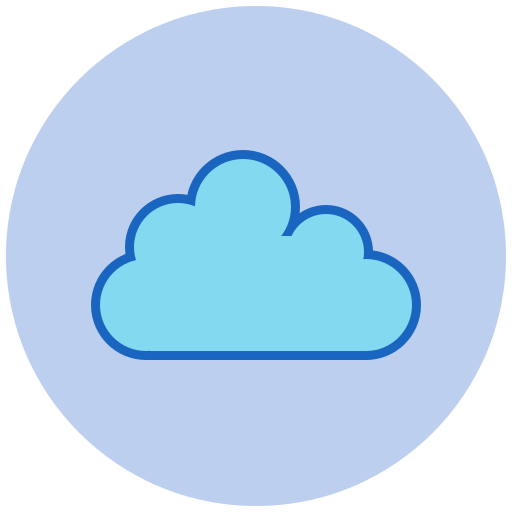
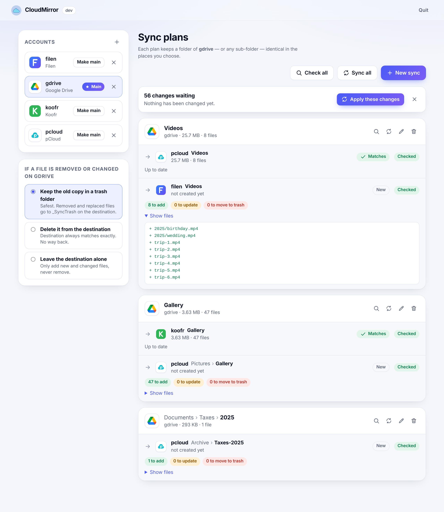

<p align="center"></p>

# CloudMirror

A small desktop app that mirrors chosen folders from one main cloud account to
other cloud accounts, using [rclone](https://rclone.org) underneath.

- Pick a main account (for example Google Drive) and connect your other accounts (pCloud, Koofr, Filen, Dropbox, OneDrive, MEGA …).
- Choose **any folder or sub-folder** of the main account, then choose **which accounts** get a copy and **which folder** on each.
- **Check for changes** lists what would be added, updated and removed, without changing anything. **Sync now** applies it.
- Removed or replaced files are moved to `_SyncTrash/<date>/` on the copy by default (or deleted, or left alone).
- Shows size and file count for every source and destination, with a Matches / Differs badge.

<p align="center"></p>

## Use

Download `CloudMirror.exe` from the [latest release](https://github.com/Jackpison/Cloud-Mirror/releases/latest) and double-click it. It opens in your browser at `http://127.0.0.1:47800` and downloads
rclone on first run. Use **Quit** in the top right to close it. Settings are stored in
`%AppData%\CloudMirror`; accounts are stored in rclone's normal config file.

### "Windows protected your PC"

The exe is not code-signed yet, so Windows SmartScreen may warn the first time: click **More info → Run anyway**.
Every release lists a SHA-256 checksum (`SHA256SUMS.txt`) and carries a GitHub build-provenance attestation, so you
can verify the file came from this repository:

```
gh attestation verify CloudMirror.exe --repo Jackpison/Cloud-Mirror
```

## Versions

See [CHANGELOG.md](CHANGELOG.md). A release is published automatically when a tag such as `v0.1.0` is pushed.

## Build

```
go install github.com/tc-hib/go-winres@v0.3.3
go-winres make --in winres/winres.json --out rsrc --arch amd64
GOOS=windows GOARCH=amd64 go build -trimpath -ldflags "-H=windowsgui -s -w -X main.version=0.1.0" -o dist/CloudMirror.exe .
```

## License

[MIT](LICENSE). CloudMirror runs the separate [rclone](https://rclone.org) program (also MIT licensed), which it downloads on first start.
